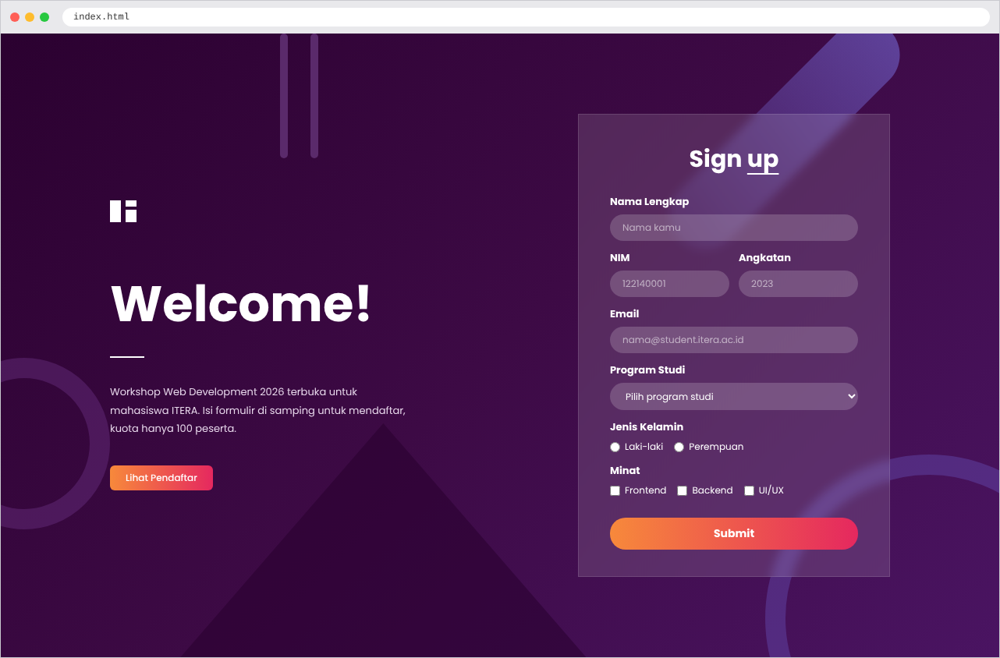
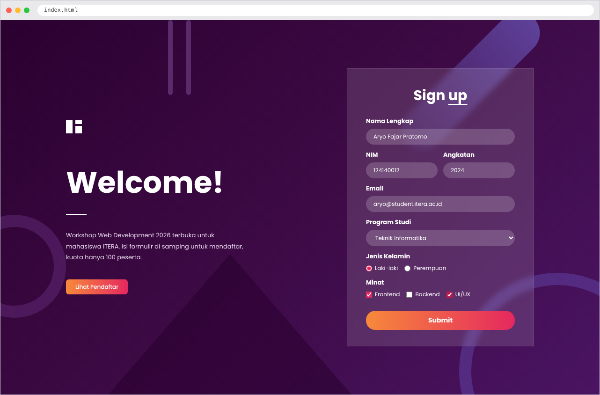
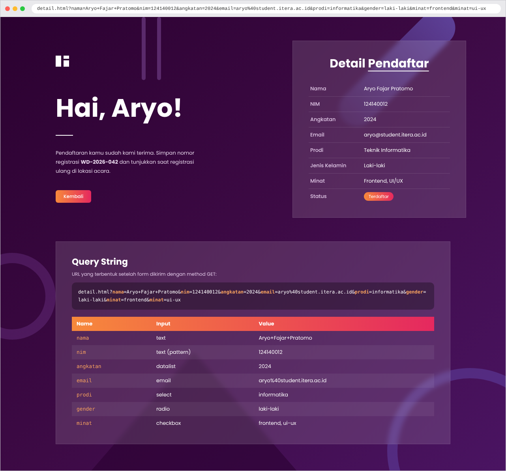
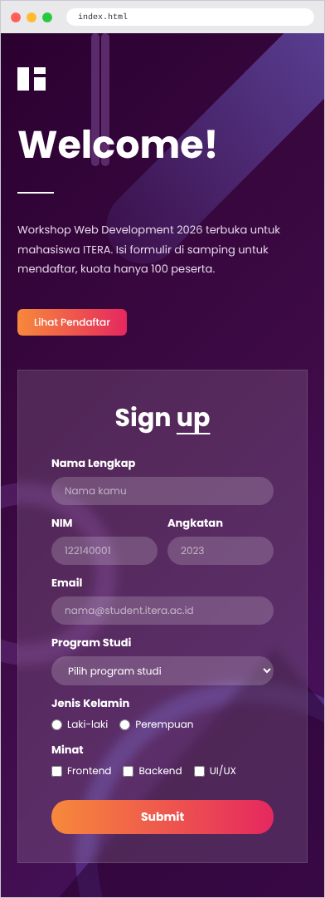

# Tugas 3 – Pengembangan Aplikasi Web

| | |
|---|---|
| **Nama** | Aryo Fajar Pratomo |
| **NIM** | 124140012 |
| **Kelas** | RA |

Halaman web sederhana untuk pendaftaran **Workshop Web Development 2026**. Website terdiri dari halaman pendaftaran dan halaman detail informasi pendaftar.

## Struktur Folder

```
task_3/
├── index.html                                  # halaman pendaftaran (form GET)
├── detail.html                                 # halaman detail pendaftar (dummy)
├── style.css                                   # desain kedua halaman
├── screenshots/                                # tangkapan layar hasil
├── RA-Aryo Fajar Pratomo-124140012-Tugas3-Pemweb.pdf
└── README.md
```

## Cara Menjalankan

1. Clone atau download repository ini.
2. Buka folder `task_3`.
3. Buka `index.html` di browser, atau gunakan ekstensi **Live Server** di VS Code.
4. Isi form lalu klik **Submit**. Halaman akan pindah ke `detail.html` dengan data terlihat di URL.

## Halaman

### 1. Halaman Pendaftaran (`index.html`)
Form menggunakan `method="GET"` dengan tujuan `detail.html`.

```html
<form id="form-daftar" action="detail.html" method="GET">
```

Elemen form yang digunakan:

| Label | Elemen | name |
|---|---|---|
| Nama Lengkap | `input type="text"` | `nama` |
| NIM | `input type="text"` + `pattern` | `nim` |
| Angkatan | `input` + `datalist` | `angkatan` |
| Email | `input type="email"` | `email` |
| Program Studi | `select` | `prodi` |
| Jenis Kelamin | `input type="radio"` | `gender` |
| Minat | `input type="checkbox"` | `minat` |

### 2. Halaman Detail Pendaftar (`detail.html`)
Berisi data pendaftar **dummy** yang ditulis langsung di HTML dalam bentuk tabel. Halaman ini tidak menangkap data dari form.

## Screenshot

**Halaman Pendaftaran**



**Form Setelah Diisi**



**Halaman Detail (query string terlihat di address bar)**



**Tampilan Mobile**



## Desain Query String

Karena form menggunakan method GET, data dikirim lewat URL. Contoh query string yang terbentuk:

```
detail.html?nama=Budi+Santoso&nim=122140001&angkatan=2022&email=budi%40student.itera.ac.id&prodi=informatika&gender=laki-laki&minat=frontend&minat=backend
```

| Key | Value | Keterangan |
|---|---|---|
| `nama` | `Budi+Santoso` | spasi menjadi `+` |
| `nim` | `122140001` | 9 digit angka |
| `angkatan` | `2022` | dari datalist |
| `email` | `budi%40student.itera.ac.id` | `@` menjadi `%40` |
| `prodi` | `informatika` | nilai dari atribut `value` option |
| `gender` | `laki-laki` | hanya satu nilai |
| `minat` | `frontend`, `backend` | key muncul berulang untuk checkbox |

## Selector CSS

| Jenis | Contoh |
|---|---|
| Universal | `*` |
| Element | `body`, `table` |
| Class | `.card`, `.btn`, `.wrapper` |
| ID | `#form-daftar` |
| Descendant | `.intro h1`, `.logo span` |
| Grouping | `input:focus, select:focus` |
| Attribute | `input[type="radio"]`, `input[type="checkbox"]` |
| Pseudo-class | `:hover`, `:focus`, `:nth-child(even)`, `:last-child` |
| Pseudo-element | `::placeholder` |

## Desain CSS

- **Layout**: CSS Grid dua kolom, Flexbox untuk pilihan radio/checkbox, dan media query agar responsif di HP.
- **Box**: kotak transparan dengan `rgba` dan `backdrop-filter: blur()`.
- **Tabel**: `border-collapse`, zebra stripes, efek hover, dan header gradasi.
- **Form**: input berbentuk kapsul, efek focus, dan tombol gradasi.
